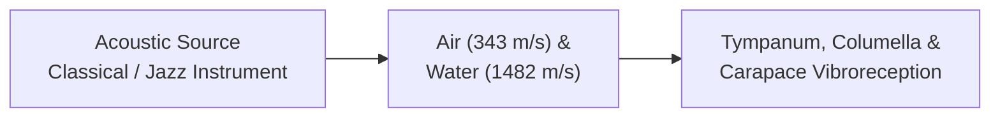

# Module XX // Lesson Title

> *"Guiding acoustic physics or chelonian bioacoustics principle."*

## 1. Executive Summary & Objectives
- [ ] Master the governing acoustic wave, harmonic, or biological reception mechanism.
- [ ] Execute hands-on terminal verification via `scripts/turtle_acoustics_lab.py`.
- [ ] Solve 3-tier graded acoustic & bioacoustic problems with explicit physical units.

## 2. Theoretical Mechanics
First-principles mathematical, physical, and neurobiological breakdown.



## 3. Hands-on Terminal Execution
```bash
# Reproducible verification commands on aarch64
python3 /data/data/com.termux/files/home/turtle-music/scripts/turtle_acoustics_lab.py --summary
```

## 4. Knowledge Graph Connections
- Vault Hub: [[README]]
- Observation Protocol: [[observations/00-observation-protocol|00 — Empirical Observation Protocol]]

## 5. Graded Problem Set & Worked Solutions

### Problem 1: Level 1 (Direct Execution)
[Question]
- **Answer:** [Exact answer with units]
- **Worked Solution:**
  1. [Step 1]
  2. [Step 2]

### Problem 2: Level 2 (Applied Scenario)
[Question]
- **Answer:** [Exact answer with units]
- **Worked Solution:**
  1. [Step 1]
  2. [Step 2]

### Problem 3: Level 3 (The Trap)
[Question]
- **Answer:** [Exact answer with units]
- **Worked Solution:**
  1. [Step 1]
  2. [Step 2]
